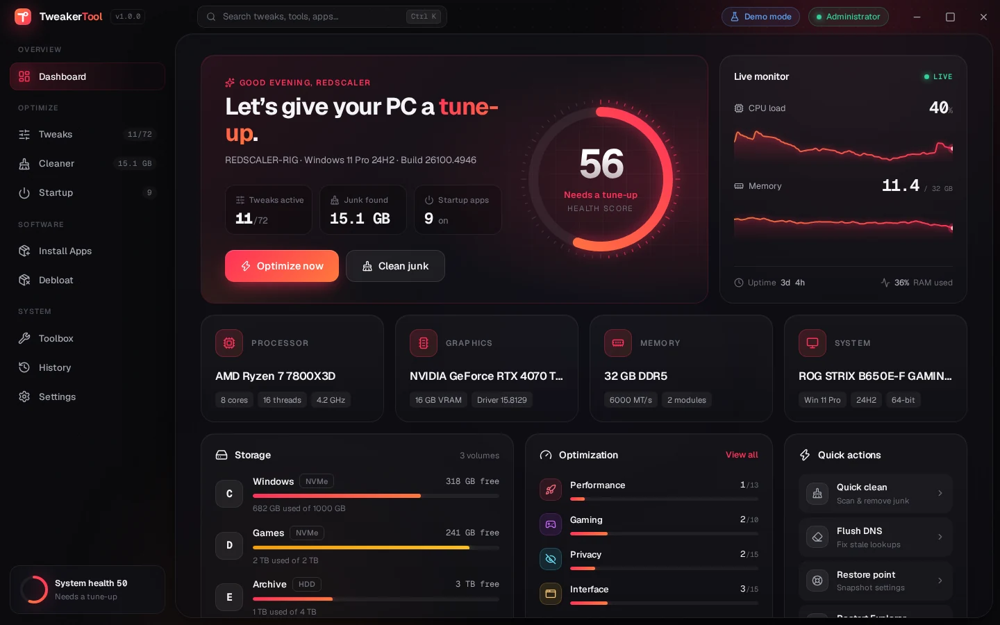
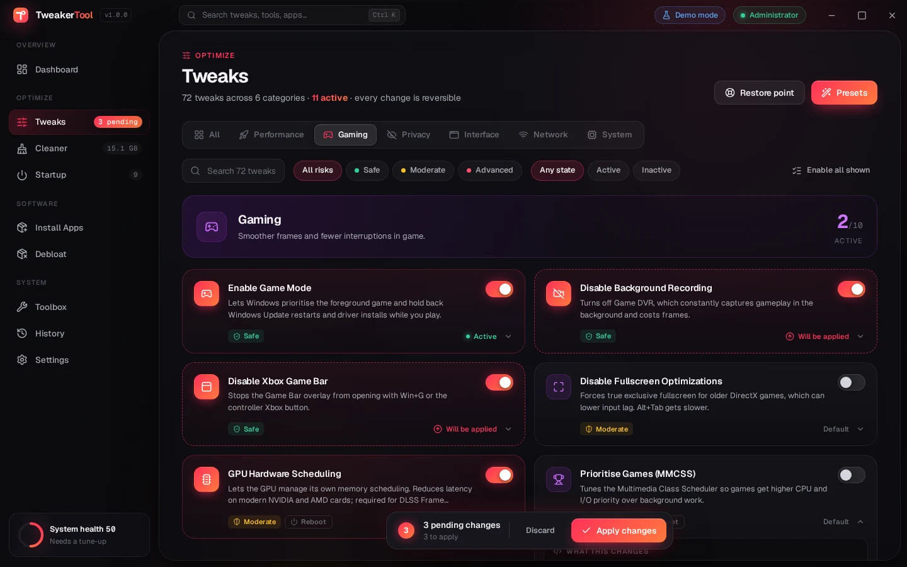
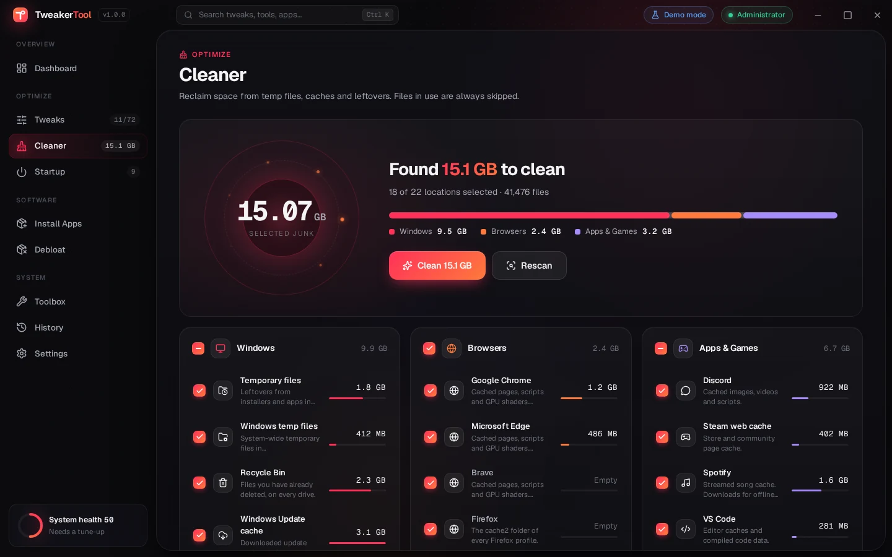
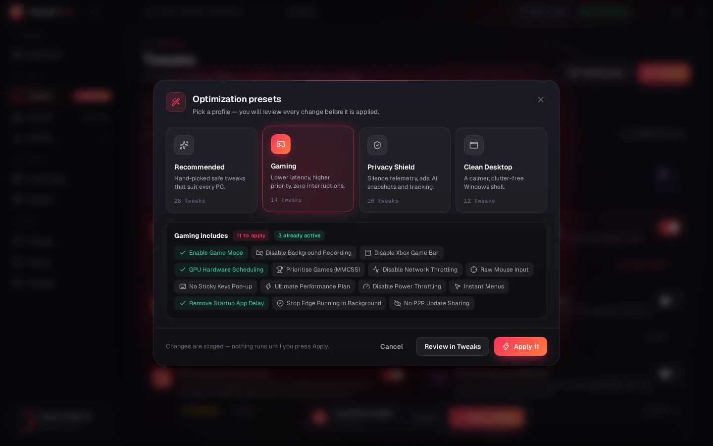
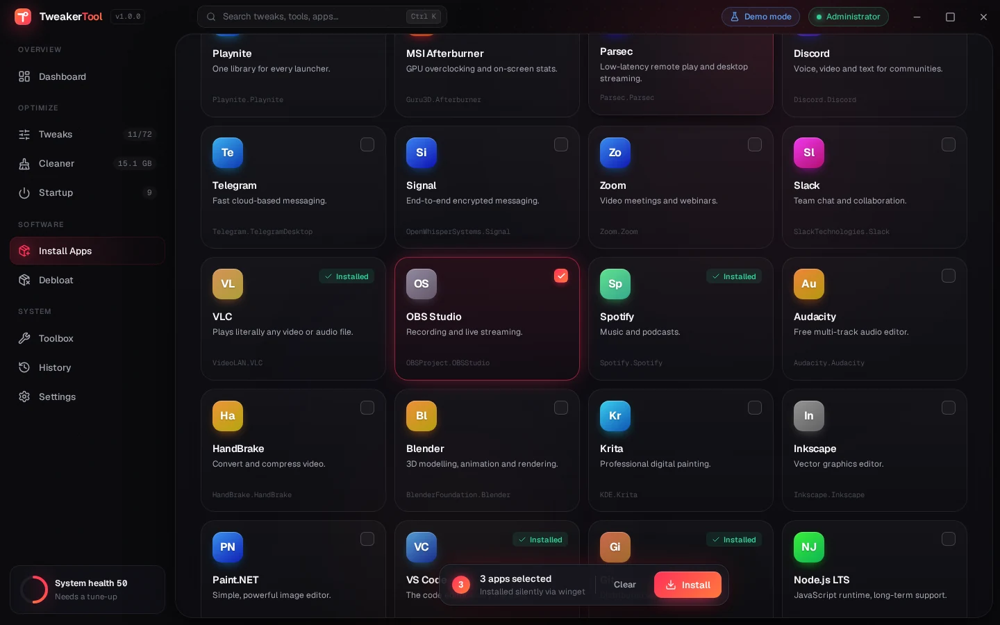
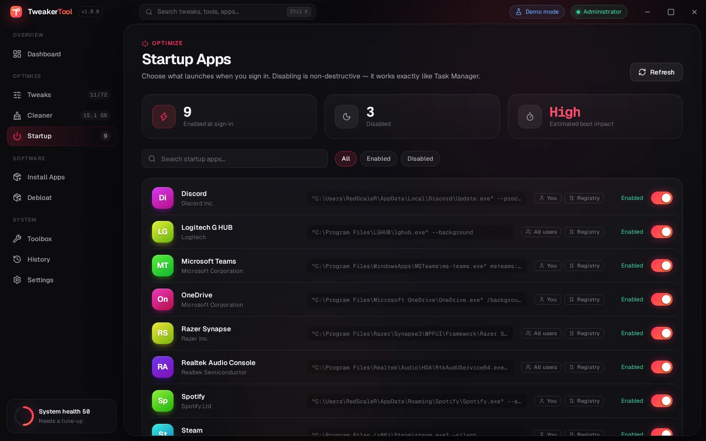
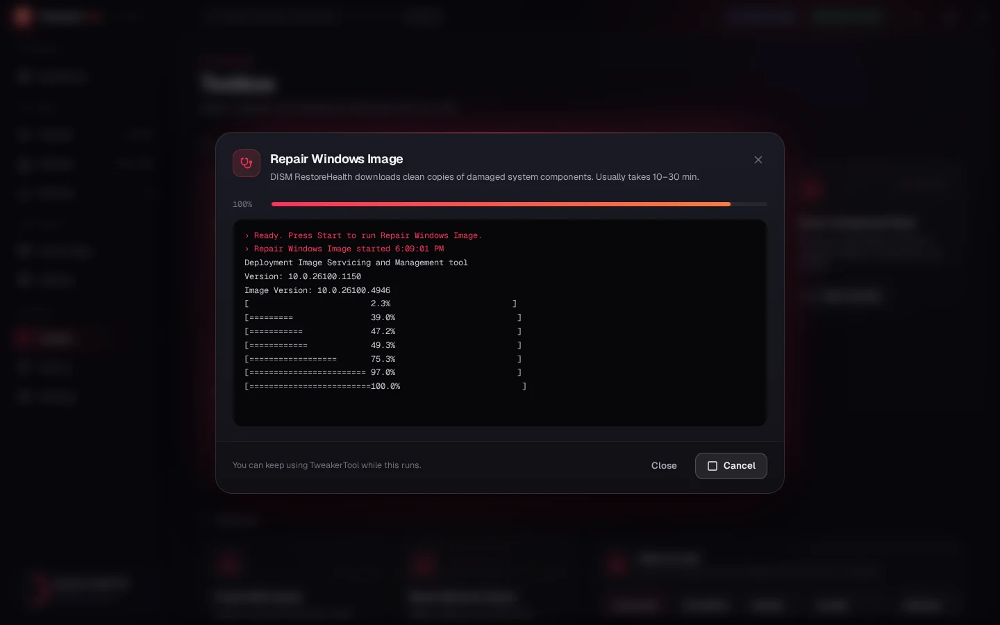
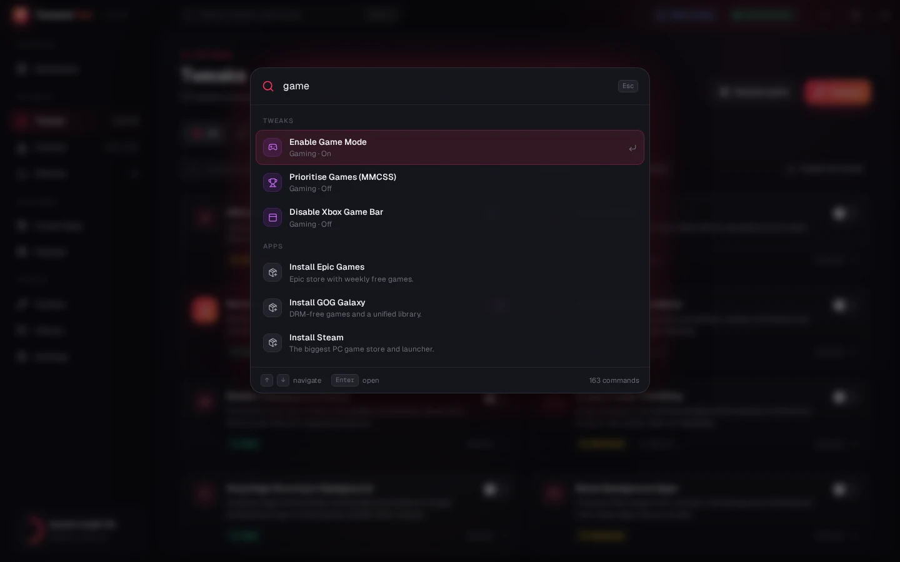
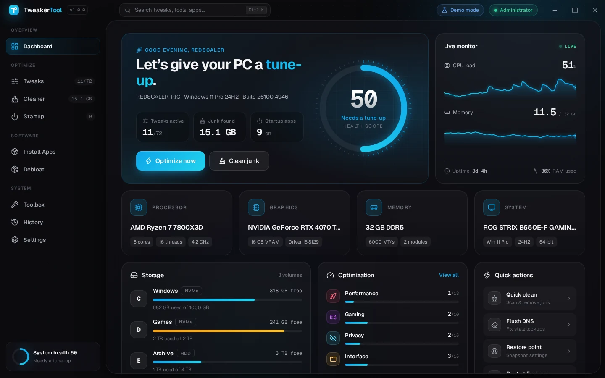

<div align="center">


# TweakerTool

**A gorgeous, all-in-one Windows optimizer.**<br/>
72 reversible tweaks · junk cleaner · startup manager · one-click app installer · debloater · repair toolbox

[](https://github.com/RedScaleR/TweakerTool/actions/workflows/ci.yml)




</div>

## ✨ Highlights

- **72 hand-picked tweaks** across Performance, Gaming, Privacy, Interface, Network and System — each with a plain-English description, a risk level (Safe / Moderate / Advanced) and a note on whether it needs a sign-out, reboot or Explorer restart.
- **Everything is reversible.** Before a tweak is applied for the first time, TweakerTool snapshots the exact registry values, service start modes and task states it is about to touch. Reverting restores that snapshot — not a guessed "default".
- **Review before you apply.** Toggles are staged as pending changes; nothing touches your system until you press **Apply changes**. A System Restore point is created first (configurable).
- **Radical transparency.** Every tweak card expands to show exactly which registry keys, services, tasks or PowerShell it runs.
- **Presets** — *Recommended*, *Gaming*, *Privacy Shield* and *Clean Desktop* — for one-click optimisation.
- **Cleaner** with a live radar scan across 22 locations: temp files, Windows Update cache, crash dumps, browser caches (Chrome, Edge, Brave, Firefox, Opera), Discord, Steam, Spotify, shader caches and more. Locked files are skipped, symlinks are never followed.
- **Startup manager** that works exactly like Task Manager (non-destructive `StartupApproved` flags), with real app icons.
- **App installer** — 55 curated apps installed silently in one batch through `winget`.
- **Debloater** for 44 preinstalled apps and promotions (Candy Crush, TikTok, Clipchamp, Bing News…), with safe picks pre-marked.
- **Toolbox** — SFC, DISM, component cleanup and CHKDSK with a live console and progress bar; DNS switcher (Cloudflare, Google, Quad9, AdGuard); network reset; Explorer restart; icon-cache rebuild; battery report; and shortcuts to 14 built-in Windows tools.
- **Live dashboard** with a health score, CPU/RAM graphs, hardware overview and storage usage.
- **Command palette** (<kbd>Ctrl</kbd> <kbd>K</kbd>) to jump to any page, tweak, tool or app.
- **Six accent themes**, animated glass UI, and full activity history.

## 📸 Screenshots

| | |
|---|---|
|  |  |
| **Tweaks** — staged changes, risk levels, full transparency | **Cleaner** — live scan with per-location breakdown |
|  |  |
| **Presets** — review every change before it runs | **Install Apps** — batch installs via winget |
|  |  |
| **Startup** — the Task Manager way, with real icons | **Toolbox** — DISM / SFC with a live console |
|  |  |
| **Command palette** — <kbd>Ctrl</kbd> <kbd>K</kbd> for everything | **Themes** — Crimson, Violet, Ocean, Emerald, Sunset, Sakura |

## 📥 Download

Grab the latest **installer** or **portable .exe** from [Releases](https://github.com/RedScaleR/TweakerTool/releases) (every `v*` tag is built and published automatically), or from the artifacts of the latest [CI run](https://github.com/RedScaleR/TweakerTool/actions/workflows/ci.yml).

TweakerTool asks for administrator rights on launch because most tweaks write to machine-wide settings. The build is not code-signed yet, so SmartScreen may show *"Windows protected your PC"* — click **More info → Run anyway**.

**Requirements:** Windows 10 (1809+) or Windows 11, x64.

## 🛡️ How it stays safe

| | |
|---|---|
| **Declarative catalog** | Tweaks are data (`src/shared/tweaks.js`): registry values, service modes, scheduled tasks, or a small check/apply/revert PowerShell trio. No arbitrary scripts from the internet. |
| **Snapshots** | Current values are captured before the first apply and stored in `%APPDATA%\TweakerTool\tweak-backups.json`. Revert writes them back exactly — deleting values that did not exist before. |
| **Restore points** | A System Restore checkpoint is created before applying tweaks (toggle in Settings). |
| **Verified state** | After every apply/revert TweakerTool re-reads the system and shows what is *actually* active. |
| **Locked-down UI** | The renderer is sandboxed with context isolation and a strict CSP. It can only ask the backend for catalog IDs — never run a command. |
| **No telemetry** | TweakerTool never phones home. The only network traffic is winget downloads you start. |

## 🛠️ Build from source

```bash
git clone https://github.com/RedScaleR/TweakerTool.git
cd TweakerTool
npm install

npm start          # run the app (Windows)
npm run demo       # run with simulated data — nothing on the PC is changed
npm run preview    # open the UI in any browser (demo mode) at http://localhost:5173
npm test           # unit tests + PowerShell syntax checks for every generated script
npm run dist       # build the NSIS installer and portable exe into dist/
```

On any OS other than Windows the app starts in demo mode automatically.

## 🧩 Adding a tweak

Add an entry to `src/shared/tweaks.js` — the UI, search, presets, status detection, backups and revert all come for free:

```js
{
  id: 'ui-file-ext',
  category: 'interface',
  title: 'Show File Extensions',
  description: 'Always shows .exe, .pdf and friends in Explorer.',
  icon: 'file-type',            // any bundled Lucide icon
  risk: 'safe',                 // safe | moderate | advanced
  recommended: true,            // part of the Recommended preset
  restart: 'explorer',          // explorer | signout | reboot (optional)
  ops: [dword(ADV, 'HideFileExt', 0, 1)],   // value when applied, value on revert
}
```

`npm test` validates the catalog and parses the generated PowerShell, and CI applies and reverts a set of real tweaks on a Windows runner to make sure every value is restored byte-for-byte.

## 📂 Project layout

```
src/
  main/        Electron main process — PowerShell runner, tweak engine, cleaner, startup, winget, toolbox
  shared/      Catalogs shared by both sides — tweaks, apps, cleaner targets, tools
  renderer/    The UI — vanilla ES modules + CSS, no build step
test/          node:test suites (catalog, engine, cleaner, PowerShell, Windows integration)
```

## 📋 All tweaks

⭐ = part of the *Recommended* preset.

<details>
<summary><b>Performance</b> — 13 tweaks</summary>

| Tweak | What it does | Risk | Applies after |
|---|---|---|---|
| Ultimate Performance Plan | Unlocks and activates the hidden Ultimate Performance power plan, which keeps the CPU out of deep idle states for the lowest latency. | 🟡 Moderate | — |
| Instant Menus ⭐ | Removes the 400 ms hover delay before cascading menus open. | 🟢 Safe | Sign out |
| Remove Startup App Delay ⭐ | Windows waits several seconds after sign-in before launching startup apps. This removes that artificial pause. | 🟢 Safe | — |
| Trim Window Animations | Disables minimize/maximize animations, taskbar animations and Aero Peek for a snappier desktop. | 🟢 Safe | Sign out |
| Disable Transparency Effects | Turns off acrylic blur in Start, the taskbar and settings. Saves GPU time on low-end and integrated graphics. | 🟢 Safe | — |
| Disable Power Throttling | Stops Windows from parking background processes on efficiency cores or low clocks. Best for desktops. | 🟡 Moderate | Reboot |
| Stop Edge Running in Background ⭐ | Disables Edge Startup Boost and background mode so it stops preloading at sign-in and staying resident after closing. | 🟢 Safe | — |
| Block Background Apps | Prevents Store apps from running in the background. Notifications from those apps may arrive late. | 🟡 Moderate | — |
| Disable SysMain (Superfetch) | Stops the service that preloads apps into RAM. Can reduce disk and memory churn on fast NVMe systems. | 🟡 Moderate | Reboot |
| Disable Search Indexing | Stops the Windows Search indexer. Frees CPU and disk, but searching files in Start and Explorer becomes slower. | 🟡 Moderate | Reboot |
| Disable Hibernation | Deletes hiberfil.sys (often 10+ GB) and disables hibernate and Fast Startup. Not ideal for laptops that hibernate. | 🟡 Moderate | — |
| Group svchost Processes | Raises the split threshold to your installed RAM so services share fewer svchost.exe processes. Less overhead, less isolation. | 🔴 Advanced | Reboot |
| Keep Kernel in RAM | Prevents kernel-mode drivers and system code from being paged to disk. Only worthwhile with 16 GB of RAM or more. | 🔴 Advanced | Reboot |

</details>

<details>
<summary><b>Gaming</b> — 10 tweaks</summary>

| Tweak | What it does | Risk | Applies after |
|---|---|---|---|
| Enable Game Mode ⭐ | Lets Windows prioritise the foreground game and hold back Windows Update restarts and driver installs while you play. | 🟢 Safe | — |
| Disable Background Recording ⭐ | Turns off Game DVR, which constantly captures gameplay in the background and costs frames. | 🟢 Safe | — |
| Disable Xbox Game Bar | Stops the Game Bar overlay from opening with Win+G or the controller Xbox button. | 🟢 Safe | — |
| Disable Fullscreen Optimizations | Forces true exclusive fullscreen for older DirectX games, which can lower input lag. Alt+Tab gets slower. | 🟡 Moderate | — |
| GPU Hardware Scheduling | Lets the GPU manage its own memory scheduling. Reduces latency on modern NVIDIA and AMD cards; required for DLSS Frame Generation. | 🟡 Moderate | Reboot |
| Prioritise Games (MMCSS) | Tunes the Multimedia Class Scheduler so games get higher CPU and I/O priority over background work. | 🟡 Moderate | Reboot |
| Disable Network Throttling | Removes the packet-rate cap Windows applies while multimedia apps are playing. | 🟡 Moderate | Reboot |
| Raw Mouse Input | Disables "Enhance pointer precision" so the cursor moves exactly as far as your hand does. Essential for aiming. | 🟢 Safe | Sign out |
| No Sticky Keys Pop-up ⭐ | Stops the Sticky, Toggle and Filter Keys prompts from interrupting when you hammer Shift in game. | 🟢 Safe | Sign out |
| Disable Multiplane Overlay | Fixes flickering, black screens and stutter in some games and browsers on certain NVIDIA and AMD drivers. | 🔴 Advanced | Reboot |

</details>

<details>
<summary><b>Privacy</b> — 15 tweaks</summary>

| Tweak | What it does | Risk | Applies after |
|---|---|---|---|
| Disable Telemetry ⭐ | Sets diagnostic data to the minimum and disables the Connected User Experiences and push-routing services. | 🟢 Safe | Reboot |
| Disable Telemetry Tasks | Disables the scheduled tasks that collect compatibility, usage and disk diagnostics in the background. | 🟡 Moderate | — |
| Disable Advertising ID ⭐ | Stops apps from using your per-user advertising ID to personalise ads across apps. | 🟢 Safe | — |
| Block Suggested Apps & Ads ⭐ | Stops Windows from silently installing promoted apps and showing suggestions in Start, Settings and the timeline. | 🟢 Safe | — |
| No Lock Screen Tips ⭐ | Removes the fun facts, tips and promotions overlaid on the lock screen. | 🟢 Safe | — |
| Disable Tailored Experiences ⭐ | Stops Microsoft from using your diagnostic data to show personalised tips, ads and recommendations. | 🟢 Safe | — |
| Disable Activity History ⭐ | Stops Windows from recording and uploading the apps, files and sites you open. | 🟢 Safe | — |
| Silence Feedback Requests ⭐ | Stops the "How likely are you to recommend Windows?" surveys and feedback notifications. | 🟢 Safe | — |
| Disable Typing & Inking Data ⭐ | Stops Windows collecting what you type and write to build a personal dictionary in the cloud. | 🟢 Safe | — |
| No Bing in Start Search ⭐ | Keeps Start menu searches local — no web results, no Bing suggestions, no keystrokes sent online. | 🟢 Safe | Explorer restart |
| Disable Copilot ⭐ | Turns off Windows Copilot and hides its taskbar button. | 🟢 Safe | Explorer restart |
| Disable Recall Snapshots ⭐ | Prevents Windows Recall from taking and analysing screenshots of your activity on Copilot+ PCs. | 🟢 Safe | — |
| Disable Cortana | Blocks Cortana through policy so it cannot run or listen. | 🟢 Safe | — |
| Disable Cloud Clipboard | Stops clipboard contents syncing across your devices through your Microsoft account. | 🟢 Safe | — |
| Disable Location Access | Denies location to every app and Windows itself. Weather, Maps and Find My Device lose your position. | 🟡 Moderate | — |

</details>

<details>
<summary><b>Interface</b> — 15 tweaks</summary>

| Tweak | What it does | Risk | Applies after |
|---|---|---|---|
| Dark Mode Everywhere | Switches both Windows and apps to the dark theme. | 🟢 Safe | — |
| Show File Extensions ⭐ | Always shows .exe, .pdf and friends in Explorer — also makes disguised malware obvious. | 🟢 Safe | Explorer restart |
| Show Hidden Files | Reveals hidden files and folders such as AppData in Explorer. | 🟢 Safe | Explorer restart |
| Open Explorer to This PC ⭐ | File Explorer opens on your drives instead of Home / Quick Access. | 🟢 Safe | Explorer restart |
| Classic Right-Click Menu | Brings back the full Windows 10 context menu — no more "Show more options". | 🟢 Safe | Explorer restart |
| Left-Aligned Taskbar | Moves the Start button and taskbar icons back to the left edge. | 🟢 Safe | — |
| "End Task" on Taskbar | Adds End Task to taskbar right-click menus to kill frozen apps without opening Task Manager. | 🟢 Safe | — |
| Remove Widgets & News ⭐ | Removes the Widgets board and the news/weather button from the taskbar. | 🟢 Safe | Explorer restart |
| Hide Task View Button | Removes the Task View button from the taskbar. Win+Tab still works. | 🟢 Safe | — |
| Hide Taskbar Search | Removes the search box from the taskbar. Press Win and start typing to search instead. | 🟢 Safe | — |
| Seconds in Taskbar Clock | Shows seconds on the system tray clock. | 🟢 Safe | Explorer restart |
| Compact Explorer Layout | Reduces the padding between items in File Explorer so more files fit on screen. | 🟢 Safe | Explorer restart |
| No " - Shortcut" Suffix | New shortcuts are named after their target without the " - Shortcut" suffix. | 🟢 Safe | Explorer restart |
| Verbose Startup Messages | Shows what Windows is doing during boot, sign-in and shutdown instead of a generic spinner. | 🟢 Safe | — |
| Num Lock On at Boot | Turns Num Lock on at the sign-in screen so your PIN works first time. | 🟢 Safe | Reboot |

</details>

<details>
<summary><b>Network</b> — 7 tweaks</summary>

| Tweak | What it does | Risk | Applies after |
|---|---|---|---|
| Disable Nagle's Algorithm | Sends small TCP packets immediately instead of batching them. Can shave milliseconds off ping in online games. | 🟡 Moderate | Reboot |
| No P2P Update Sharing ⭐ | Stops Windows Update from uploading updates to other PCs on the internet using your bandwidth. | 🟢 Safe | — |
| Prefer IPv4 over IPv6 | Keeps IPv6 enabled but makes Windows try IPv4 first. Fixes slow connects on networks with broken IPv6. | 🟡 Moderate | Reboot |
| Disable Teredo Tunneling | Turns off the Teredo IPv6-over-IPv4 tunnel. Some Xbox party chat features rely on it. | 🟡 Moderate | — |
| Disable LLMNR ⭐ | Turns off Link-Local Multicast Name Resolution, a legacy protocol commonly abused to steal credentials on shared networks. | 🟢 Safe | — |
| Disable SMBv1 Server ⭐ | Switches off the insecure SMB 1.0 file-sharing protocol exploited by WannaCry. | 🟢 Safe | — |
| Disable Remote Assistance ⭐ | Blocks incoming Remote Assistance invitations — a favourite of tech-support scammers. | 🟢 Safe | — |

</details>

<details>
<summary><b>System</b> — 12 tweaks</summary>

| Tweak | What it does | Risk | Applies after |
|---|---|---|---|
| No Surprise Update Restarts ⭐ | Windows Update will never reboot automatically while you are signed in. | 🟢 Safe | — |
| Exclude Drivers from Updates | Stops Windows Update replacing your GPU and chipset drivers with older generic versions. | 🟡 Moderate | — |
| Disable Fast Startup | Makes Shut Down a real shutdown. Fixes dual-boot issues, stale drivers and uptime that never resets. | 🟢 Safe | — |
| Enable Long Paths ⭐ | Lifts the 260-character path limit for apps that support it — handy for developers and deep folder trees. | 🟢 Safe | — |
| Detailed Blue Screens ⭐ | Shows the technical stop parameters on crash screens instead of just a sad face. | 🟢 Safe | — |
| Enable Storage Sense | Lets Windows clear temporary files and old Recycle Bin items automatically when space runs low. | 🟢 Safe | — |
| Disable Error Reporting ⭐ | Stops crash reports being queued and sent to Microsoft, and frees the disk space they use. | 🟢 Safe | — |
| Disable Offline Maps Service | Stops the background service that downloads and updates offline maps. | 🟢 Safe | — |
| Disable Fax Service | It is not 1998 anymore. | 🟢 Safe | — |
| Disable Print Spooler | Closes a service with a long history of critical exploits. Only use if you never print. | 🟡 Moderate | — |
| Disable Xbox Services | Disables Xbox Live auth, cloud saves and networking services. Breaks the Xbox app and Game Pass PC games. | 🟡 Moderate | — |
| Disable Reserved Storage | Releases the ~7 GB Windows holds back for updates. Large updates may then need you to free space manually. | 🔴 Advanced | — |

</details>

## 🙏 Credits

- [Geist](https://github.com/vercel/geist-font) font — SIL Open Font License 1.1
- [Lucide](https://lucide.dev) icons — ISC License
- Built with [Electron](https://www.electronjs.org/)

---

<div align="center"><sub>Made with ❤️ by <b>RedScaleR</b></sub></div>
